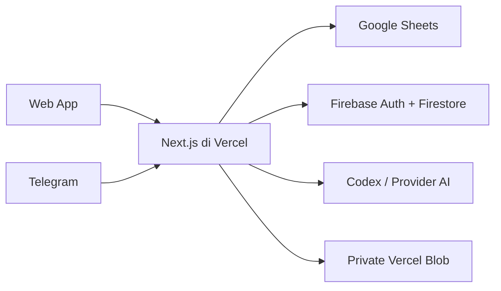

# Pusat Data Pemberdayaan Rumah Zakat

Pusat Data Pemberdayaan Rumah Zakat adalah aplikasi dashboard internal untuk menyatukan, menelusuri, dan memvisualisasikan data program pemberdayaan Rumah Zakat. Aplikasi mengolah sejumlah Google Spreadsheet menjadi informasi target, capaian, sebaran wilayah, peserta program, dan indikator dampak yang lebih mudah dibaca.

🌐 **Production:** [pemberdayaan-rz.vercel.app](https://pemberdayaan-rz.vercel.app)

## Fitur Utama

- **Dashboard program** — target, capaian, persentase OKR, periode, dan ringkasan eksekutif.
- **Peserta Program** — filter periode dan wilayah, komposisi program dan asnaf, laporan formal, serta ekspor CSV, Excel, dan PDF.
- **Desa Berdaya** — peta Indonesia, pencarian desa/wilayah, status, tipe desa, program, profil desa, dan Relawan Inspirasi.
- **Dampak Program** — visualisasi indikator ekonomi, pendidikan, kesehatan, lingkungan, dan dakwah.
- **Detail indikator** — analisis Muzaki, Munfik, Mualaf, BUMMas, Peserta Program Terbina, dan peserta keluar garis kemiskinan.
- **Asisten Data Program RZ** — chatbot AI untuk mencari angka, wilayah, program, definisi, katalog, sumber, dan rekonsiliasi data.
- **Telegram Bot** — akses Asisten Data Program tanpa membuka aplikasi web.
- **Onboarding dan akses** — login Google atau email/password, approval akun eksternal, serta panel administrasi pengguna.
- **Cache data** — navigasi antarlaman tetap ringan dan data dapat dimuat ulang ketika diperlukan.

## Tampilan Aplikasi

Navigasi utama terdiri dari:

| Halaman | Route | Keterangan |
|---|---|---|
| Dashboard | `/` | Ringkasan target dan capaian program |
| Peserta Program | `/ikhtisar-pp-plp` | Analisis dan laporan Peserta Program |
| Desa Berdaya | `/peta-sebaran` | Peta dan portofolio Desa Berdaya |
| Dampak Program | `/dampak-program` | Target, capaian, dan indikator dampak |
| Keluar Garis Kemiskinan | `/garis-kemiskinan` | Detail dan tren capaian GK |
| Muzaki | `/muzzaki` | Detail serta insight Muzaki |
| Munfik | `/munfik` | Detail serta insight Munfik |
| Mualaf | `/mualaf` | Detail serta insight Mualaf |
| BUMMas | `/bummas` | Portofolio unit usaha masyarakat |
| PP Terbina | `/pp-terbina` | Detail Peserta Program Terbina |
| Admin Pengguna | `/admin/pengguna` | Approval dan pengelolaan akses |

## Arsitektur Singkat



- Browser hanya mengakses data melalui API Next.js.
- Google Sheets dibaca oleh server melalui ekspor CSV dan dinormalisasi sesuai kamus data aplikasi.
- Firebase Authentication menangani login; Firestore menyimpan profil dan status approval.
- Session aplikasi menggunakan cookie `HttpOnly`, `Secure`, dan `SameSite=Lax` selama tujuh hari.
- Chatbot menggunakan fungsi query terkontrol sehingga angka dihitung dari sumber data, bukan dikarang oleh model.
- Login ChatGPT Business dapat disimpan secara terenkripsi di Private Vercel Blob.

## Sumber Data

Aplikasi saat ini memakai sumber berikut:

| Data | Keterangan |
|---|---|
| Target dan Capaian Dashboard | Target tahunan dan capaian bulanan program |
| Peserta Program | Program, subprogram, asnaf, periode, cabang, dan wilayah |
| Analisa Capaian PP dan PLP | Ringkasan kinerja per program/divisi serta tren bulanan PP per program dan divisi |
| Desa Berdaya | Desa, status, tipe, program, cabang, dan Relawan Inspirasi |
| Munfik | Tiga blok sumber: Empowerment, Progdis, dan Dakwah |
| Muzaki, Mualaf, PP Terbina, BUMMas | Dataset detail per indikator |
| Keluar Garis Kemiskinan | Data peserta dan rekap multitahun |
| Dampak Vokasi dan Hafidz | Peserta terserap kerja, berwirausaha, dan Hafidz 30 juz |
| Bank Sampah, Mangrove, dan Masjid Berdaya | Outcome lingkungan dan dakwah beserta detail wilayah yang tersedia |
| Katalog Program Rumah Zakat 2026 | Pengetahuan program untuk chatbot |
| Website resmi Rumah Zakat | Rujukan informasi program dan lembaga |

Konfigurasi spreadsheet dipusatkan pada `src/lib/data-catalog.ts` dan dapat diganti melalui Environment Variables.

### Aturan perhitungan penting

- Peserta Program dihitung dengan **SUM kolom JUMLAH**, bukan jumlah baris atau nama unik.
- Munfik dihitung dari **jumlah seluruh baris valid** pada tiga blok sumber, bukan nominal.
- Mualaf dihitung dari baris dengan **Nama PM terisi**, tanpa membuat nama unik.
- BUMMas detail dihitung dari seluruh baris valid dengan **bidang usaha/program terisi**. Pada sumber Desa Berdaya, nilai seperti `2 BUMMas` dihitung sebagai dua unit.
- Desa Aktif mengikuti status `Aktif`; titik program menjumlahkan unit pada setiap hubungan desa dengan program.
- Target Dashboard diambil satu kali sebagai target tahunan, sedangkan capaian dijumlahkan menurut periode bulan terpilih.
- Analisa periode PP menjumlahkan target, capaian, dan history setiap bulan. Persentase tahunan/akumulasi hanya mengambil snapshot bulan terakhir dan tidak dijumlahkan.
- Nilai kosong dibedakan dari nilai nol.

Kamus lengkap beserta alias pencarian tersedia di `src/lib/metric-dictionary.ts`.

## Teknologi

- Next.js 15 App Router
- React 19 dan TypeScript
- Tailwind CSS
- Recharts
- Leaflet dan React Leaflet
- Firebase Authentication
- Cloud Firestore
- Codex App Server / provider OpenAI-compatible
- Vercel Blob dan Vercel Cron
- Telegram Bot API
- jsPDF dan `write-excel-file`

## Menjalankan Secara Lokal

### Prasyarat

- Node.js LTS
- npm
- konfigurasi Firebase
- akses ke Google Sheets sumber
- konfigurasi provider AI jika ingin menguji chatbot

### Instalasi

```bash
npm install
```

Salin `.env.example` menjadi `.env.local`, lalu isi konfigurasi lokal yang diperlukan. Jangan commit `.env.local` atau file kredensial apa pun.

```bash
npm run dev
```

Buka [http://localhost:3000](http://localhost:3000).

Untuk menguji mode production:

```bash
npm run build
npm run start
```

## Environment Variables

Daftar lengkap terdapat pada `.env.example`. Variabel dikelompokkan menjadi:

### Google Sheets

```text
GOOGLE_SHEETS_DASHBOARD_ID / GID
GOOGLE_SHEETS_PP_ID / GID
GOOGLE_SHEETS_DISTRIBUTION_ID / GID
GOOGLE_SHEETS_MUNFIK_ID / GID
GOOGLE_SHEETS_MUZZAKI_ID / GID
GOOGLE_SHEETS_MUALAF_ID / GID
GOOGLE_SHEETS_PP_TERBINA_ID / GID
GOOGLE_SHEETS_BUMMAS_ID / GID
GOOGLE_SHEETS_GK_ID / GID
GOOGLE_SHEETS_GK_RECAP_ID / GID
GOOGLE_SHEETS_VOKASI_IMPACT_ID / GID
GOOGLE_SHEETS_HAFIDZ_IMPACT_ID / GID
GOOGLE_SHEETS_ENVIRONMENT_IMPACT_ID / GID
```

### Firebase

```text
NEXT_PUBLIC_FIREBASE_API_KEY
NEXT_PUBLIC_FIREBASE_AUTH_DOMAIN
NEXT_PUBLIC_FIREBASE_PROJECT_ID
NEXT_PUBLIC_FIREBASE_APP_ID
FIREBASE_PROJECT_ID
FIREBASE_CLIENT_EMAIL
FIREBASE_PRIVATE_KEY
AUTH_ADMIN_EMAILS
```

### AI dan penyimpanan autentikasi

```text
AI_PROVIDER
CODEX_MODEL
CODEX_REASONING_EFFORT
CODEX_ACCESS_TOKEN
CODEX_AUTH_ENCRYPTION_KEY
CODEX_AUTH_REFRESH_SKEW_MS
BLOB_STORE_ID
BLOB_READ_WRITE_TOKEN
CRON_SECRET
TAVILY_API_KEY
```

Provider alternatif yang tersedia: Groq, OpenRouter, 9Router, dan custom OpenAI-compatible endpoint.
`TAVILY_API_KEY` bersifat opsional dan hanya digunakan untuk pencarian web eksternal pada domain institusional tepercaya. Website resmi Rumah Zakat tetap dicari langsung tanpa API key.

### Telegram

```text
TELEGRAM_BOT_TOKEN
TELEGRAM_WEBHOOK_SECRET
TELEGRAM_PUBLIC_URL
TELEGRAM_BOT_USERNAME
NEXT_PUBLIC_APP_URL
```

## Autentikasi dan Approval

- Akun `@rumahzakat.org` otomatis dikategorikan sebagai akun internal.
- Akun eksternal masuk dengan status `pending` hingga disetujui admin.
- Email/password wajib melalui verifikasi email.
- Login Google mengikuti aturan internal dan eksternal yang sama.
- Login Google sudah memiliki fallback redirect untuk Safari/mobile ketika pop-up diblokir.
- Firestore tidak dapat diakses langsung dari browser; profil dikelola melalui API server.
- Admin utama didefinisikan melalui `AUTH_ADMIN_EMAILS`.

## Asisten Data Program RZ

Chatbot dirancang untuk menjawab antara lain:

- “Berapa total Peserta Program Januari–Juli 2026?”
- “Urutkan lima program dengan peserta terbesar.”
- “Lampirkan desa yang ada di Papua.”
- “Berapa Munfik per sumber sampai Juli?”
- “Kota dengan jumlah Muzaki terbanyak?”
- “Apa itu program Rumah Vokasi?”
- “Apakah data Dashboard dan detail sudah cocok?”
- “Program PP mana yang paling tertinggal dari target dan apa prioritas tindak lanjutnya?”
- “Bandingkan kinerja PP per divisi sampai Agustus.”
- “Bagaimana tren bulanan PP dibanding target dan capaian tahun lalu?”
- “Berapa peserta vokasi terserap kerja dan berwirausaha?”

Pertanyaan angka diarahkan ke fungsi data yang sesuai. Jawaban menyertakan periode dan sumber. Untuk pertanyaan analitis, chatbot memisahkan temuan data, interpretasi, dan rekomendasi; membandingkan target, history, growth, kontribusi, tren, dan gap; serta menyatakan keterbatasan data sebelum memberi saran. Normalisasi mendukung singkatan serta variasi ejaan umum seperti PM/PP, Muzaki/Muzzaki, Munfik/Munfiq, dan nama wilayah singkat.

Untuk pertanyaan gabungan, angka capaian tetap diambil dari Google Sheets, sedangkan benchmark, regulasi, SDGs/CSR, dan praktik eksternal dicari melalui Tavily hanya pada domain tepercaya. Backend membuka maksimal tiga halaman teratas, memilih potongan yang relevan, memeriksa metadata tanggal, lalu menyusun jawaban dalam bagian Fakta internal, Konteks eksternal, Interpretasi, Rekomendasi, dan Sumber. Website resmi Rumah Zakat tetap dapat dicari tanpa Tavily.

### Persistensi Codex di Vercel

Jika menggunakan Login ChatGPT Business, sesi Codex disimpan terenkripsi di Private Blob:

```text
rz-dashboard/codex-auth.v1.enc
```

Token hanya disegarkan saat mendekati kedaluwarsa. Refresh juga dijalankan terjadwal melalui:

```text
GET /api/assistant/auth-refresh
```

Admin dapat melihat status melalui `/api/assistant/status` dan menghubungkan ulang akun melalui UI jika sesi dicabut.

## Telegram Bot

Perintah yang tersedia:

```text
/tanya <pertanyaan>
/status
/reset
/help
```

Pengaturan webhook:

```bash
npm run telegram:webhook:set
npm run telegram:webhook:info
npm run telegram:webhook:delete
```

Webhook production disinkronkan pada proses `postbuild` apabila token, secret, dan URL publik telah tersedia.

## Cache dan Performa

- Cache server memiliki TTL default 30 menit.
- Browser menggunakan memory cache dan IndexedDB.
- Perpindahan halaman memakai cache yang sudah tersedia.
- Refresh browser atau tombol **Muat ulang** dapat meminta data terbaru.
- Permintaan data yang sama dan berjalan bersamaan digabung untuk mengurangi fetch berulang.
- Komponen grafik dan peta dimuat secara dinamis agar initial bundle lebih ringan.

## Script

| Perintah | Fungsi |
|---|---|
| `npm run dev` | Menjalankan development server dengan Turbopack |
| `npm run typecheck` | Memeriksa tipe TypeScript |
| `npm run lint` | Menjalankan ESLint |
| `npm run build` | Membuat production build |
| `npm run start` | Menjalankan hasil production build |
| `npm run telegram:webhook:set` | Memasang webhook Telegram |
| `npm run telegram:webhook:info` | Memeriksa webhook Telegram |
| `npm run telegram:webhook:delete` | Menghapus webhook Telegram |

## Keamanan

- Jangan menyimpan secret di repository.
- Private key Firebase, token Telegram, API key AI, dan kunci enkripsi hanya disimpan pada environment server.
- Private Vercel Blob digunakan untuk sesi ChatGPT Business.
- Semua API data memverifikasi session Firebase dan status approval.
- Webhook Telegram memverifikasi secret header Telegram.
- Firestore Rules menolak akses langsung dari browser.
- Data Google Sheets saat ini memerlukan akses ekspor CSV; hindari menaruh identitas atau data sensitif pada sheet yang dibagikan publik.

## Validasi Sebelum Deployment

```bash
npm run typecheck
npm run lint
npm run build
```

Setelah deployment, uji:

1. Login email/password dan Google.
2. Approval akun eksternal.
3. Dashboard dan tombol Muat ulang.
4. Filter serta ekspor laporan Peserta Program.
5. Peta dan detail Desa Berdaya.
6. Chatbot web dan sumber jawabannya.
7. `/status` dan pertanyaan melalui Telegram.
8. Status Blob serta Cron refresh Codex.

## Status Pengembangan

Aplikasi masih berkembang. Google Sheets tetap menjadi backend data operasional, sementara Firebase digunakan untuk identitas dan approval pengguna. Pengembangan berikutnya dapat mencakup validasi skema sumber, audit perubahan data, cache bersama antarfungsi, kontrol akses Telegram, dan fitur AI kontekstual seperti **Tanya Tampilan Ini**.

---

Copyright © 2026 Rumah Zakat — Program Data Optimization Department. All rights reserved.
